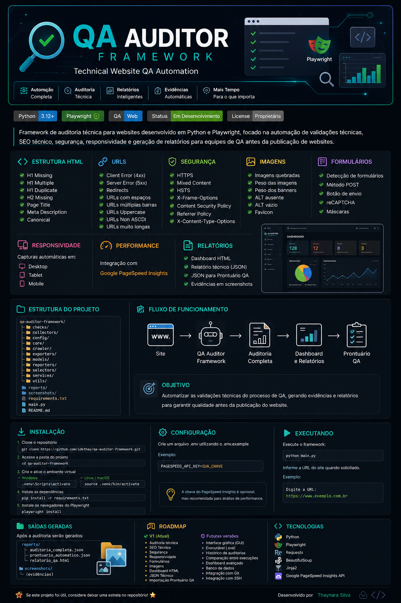

<p align="center">
  
</p>

<div align="center">

# 🔍 QA Auditor Framework

### Technical Website QA Automation Framework

Framework de auditoria técnica para websites desenvolvido em **Python** e **Playwright**, focado na automação de validações técnicas, SEO técnico, segurança, responsividade e geração de relatórios para equipes de QA.


</div>

---

# 📑 Índice

- [📖 Sobre](#-sobre)
- [🚀 Funcionalidades](#-funcionalidades)
- [📂 Estrutura](#-estrutura)
- [⚙️ Instalação](#️-instalação)
- [🔑 Configuração](#-configuração)
- [▶️ Executando](#️-executando)
- [📊 Resultado](#-resultado)
- [🎯 Objetivo da V1](#-objetivo-da-v1)
- [🛣️ Roadmap](#️-roadmap)
- [🛠️ Tecnologias](#️-tecnologias)
- [💡 Filosofia](#-filosofia)
- [👩‍💻 Autora](#-autora)

---

# 📖 Sobre

O **QA Auditor Framework** foi desenvolvido para automatizar auditorias técnicas realizadas durante o processo de Quality Assurance em websites.

O framework reduz o tempo gasto com validações manuais, padroniza auditorias técnicas e gera evidências automáticas para apoio à homologação de projetos web.

Atualmente a ferramenta realiza dezenas de validações técnicas utilizadas no processo de QA, produzindo relatórios completos e screenshots automáticos durante a auditoria.

---

# 📊 Cobertura da Auditoria

- ✅ 70+ validações automáticas
- 🌐 SEO Técnico
- 🔒 Segurança
- 📱 Responsividade
- 📬 Formulários
- 🖼️ Imagens
- ⚡ Performance (PageSpeed)
- 📄 Dashboard HTML
- 📋 Relatório JSON
- 📥 Importação para Prontuário QA

---

# 🚀 Funcionalidades

## 📑 Estrutura HTML

- H1 Missing
- H1 Multiple
- H1 Duplicate
- H2 Missing
- Canonical
- Page Titles
- Meta Descriptions

---

## 🌐 URLs

- Client Error (4xx)
- Server Error (5xx)
- Redirects
- URLs Uppercase
- URLs com espaços
- URLs com múltiplas barras
- URLs Non ASCII
- URLs muito longas

---

## 🔒 Segurança

- HTTPS
- Mixed Content
- HSTS
- X-Frame-Options
- Content Security Policy
- Secure Referrer Policy
- X-Content-Type-Options

---

## 🖼️ Imagens

- Imagens quebradas
- Peso das imagens
- Peso dos banners
- ALT ausente
- ALT vazio
- Favicon

---

## 📬 Formulários

- Detecção automática
- Método POST
- Botão de envio
- reCAPTCHA
- Máscaras de campos

---

## 📱 Responsividade

Capturas automáticas em:

- 🖥️ Desktop
- 💻 Tablet
- 📱 Mobile

---

## ⚡ Performance

Integração com:

- Google PageSpeed Insights API

---

## 📄 Relatórios

Ao final da auditoria são gerados automaticamente:

- Dashboard HTML
- Relatório Técnico JSON
- JSON para importação no Prontuário QA
- Screenshots das evidências

---

# 📂 Estrutura

```text
qa-auditor-framework/

├── checks/
├── collectors/
├── config/
├── core/
├── crawler/
├── exporters/
├── models/
├── reporters/
├── selectors/
├── services/
├── utils/

├── reports/
├── screenshots/

├── requirements.txt
├── README.md
└── main.py
```

---

# ⚙️ Instalação

Clone o projeto

```bash
git clone https://github.com/idkthay/qa-auditor-framework.git
```

Entre na pasta

```bash
cd qa-auditor-framework
```

Crie o ambiente virtual

```bash
python -m venv .venv
```

Windows

```bash
.venv\Scripts\activate
```

Linux / macOS

```bash
source .venv/bin/activate
```

Instale as dependências

```bash
pip install -r requirements.txt
```

Instale os navegadores do Playwright

```bash
playwright install
```

---

# 🔑 Configuração

Crie um arquivo `.env` utilizando o `.env.example`.

Exemplo:

```env
PAGESPEED_API_KEY=SUA_CHAVE
```

---

# ▶️ Executando

```bash
python main.py
```

Informe a URL do site quando solicitado.

Exemplo:

```text
Digite a URL:

https://www.exemplo.com.br
```

---

# 📊 Resultado

Após a auditoria serão gerados automaticamente:

```text
reports/

├── auditoria_completa.json
├── prontuario_automatico.json
└── relatorio_qa.html
```

Além disso, serão salvas todas as evidências em:

```text
screenshots/
```

---

# 🎯 Objetivo da V1

A primeira versão do framework possui foco exclusivo em automatizar as validações técnicas utilizadas no processo de QA.

Nesta versão foram priorizadas validações que podem ser corrigidas diretamente pela equipe técnica responsável pelo desenvolvimento do website, evitando análises subjetivas de conteúdo ou marketing.

---

# 🛣️ Roadmap

## ✅ V1 (Atual)

- Auditoria técnica
- SEO Técnico
- Segurança
- Responsividade
- Formulários
- Imagens
- Dashboard HTML
- Relatórios JSON
- Importação para Prontuário QA

---

## 🔮 Futuras versões

- Interface gráfica (GUI)
- Executável (.exe)
- Histórico de auditorias
- Comparação entre execuções
- Dashboard avançado
- Banco de dados
- Integração com Git
- Integração com SSH

---

# 🛠️ Tecnologias

- Python
- Playwright
- Requests
- BeautifulSoup
- Jinja2
- Google PageSpeed Insights API

---

# 💡 Filosofia

O QA Auditor Framework foi desenvolvido seguindo um princípio simples:

> **Automatizar tudo o que pode ser validado tecnicamente, deixando para o analista apenas aquilo que realmente exige análise humana.**

Essa abordagem reduz o tempo de auditoria, aumenta a padronização das validações e permite que a equipe concentre esforços em análises de maior valor.

---

# 👩‍💻 Autora

Desenvolvido por **Thaynara Silva**.

Se este projeto foi útil para você, considere deixar uma ⭐ no repositório.